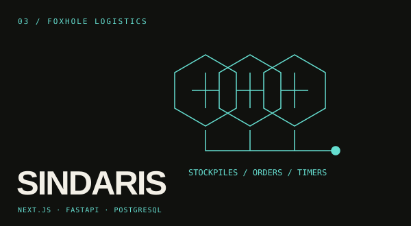
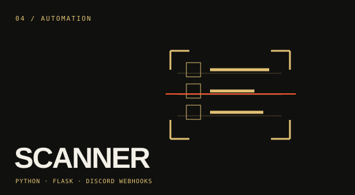

  
    
  <a href="https://studio-web-prototype.reppot-6.chatgpt.site/">Портфолио</a>
  &nbsp; / &nbsp;
  <a href="https://t.me/he_real_slim_shady">Telegram</a>
  &nbsp; / &nbsp;
  <a href="https://github.com/Reppot?tab=repositories">Репозитории</a>

 

Создаю сайты с выразительной графикой, интерактивные интерфейсы и инструменты автоматизации на Python. В моих проектах — WebGL-витрины, конфигураторы, интернет-магазин и сервисы для игровой логистики.

### Избранные проекты

<table>
<tr>
<td width="50%" valign="top">

WebGL-витрина, анимации прокрутки и 3D-конфигуратор мебели.

<a href="https://studio-web-prototype.reppot-6.chatgpt.site/"><b>Открыть сайт ↗</b></a> &nbsp; · &nbsp; <a href="https://github.com/Reppot/Studio">Код</a>

</td>
<td width="50%" valign="top">

Каталог одежды, корзина и редактор принтов на Canvas 2D с экспортом заказа.

<a href="https://our-souls-shop.onrender.com/"><b>Открыть сайт ↗</b></a> &nbsp; · &nbsp; <a href="https://github.com/Reppot/Oursouls">Код</a>

</td>
</tr>
<tr>
<td width="50%" valign="top">

Склады, заявки, таймеры резервов и расчёт производства для Foxhole.

<a href="https://sandalis-web-v2-0.onrender.com/"><b>Открыть сайт ↗</b></a> &nbsp; · &nbsp; <a href="https://github.com/Reppot/Sandalis-web-v2.0">Код</a>

</td>
<td width="50%" valign="top">

Русская локализация и доставка отчётов о складах в Discord. На основе <a href="https://github.com/xurxogr/foxhole-stockpiles">foxhole-stockpiles</a>.

<a href="https://github.com/Reppot/Foxhole-Storage-Scanner"><b>Открыть проект ↗</b></a>

</td>
</tr>
</table>

### Языки и технологии

  

  

Стек из публичных репозиториев Studio, Our Souls и SINDARIS.

### Статистика GitHub

  
  

Статистика языков отражает состав репозиториев.
