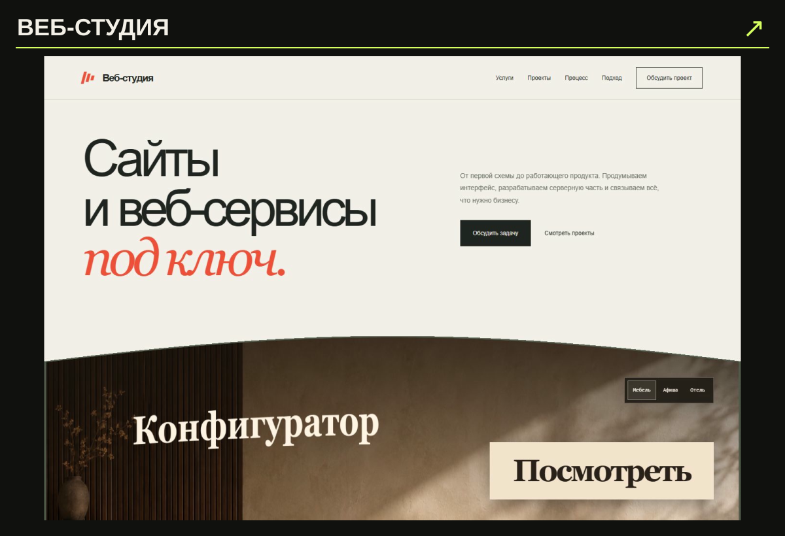
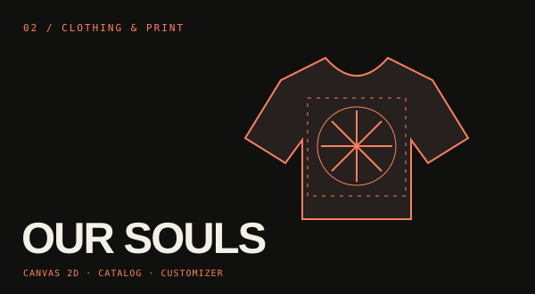

  
    
  <a href="https://studio-web-prototype.reppot-6.chatgpt.site/">Портфолио</a>
  &nbsp; / &nbsp;
  <a href="https://t.me/he_real_slim_shady">Телеграм</a>
  &nbsp; / &nbsp;
  <a href="https://github.com/Reppot?tab=repositories">Репозитории</a>

 

Создаю сайты с выразительной графикой, интерактивные интерфейсы и инструменты автоматизации на Python. В моих проектах — трёхмерные витрины, конфигураторы, интернет-магазин и сервисы для игровой логистики.

### Избранные проекты

Витрина проектов с трёхмерной графикой, анимациями и конфигуратором мебели.

[**Открыть сайт ↗**](https://studio-web-prototype.reppot-6.chatgpt.site/) · [Код](https://github.com/Reppot/Studio)

 

Каталог одежды, корзина и редактор принтов с экспортом заказа.

[**Открыть сайт ↗**](https://our-souls-shop.onrender.com/) · [Код](https://github.com/Reppot/Oursouls)

 

Склады, заявки, таймеры резервов и расчёт производства для Foxhole.

[**Открыть сайт ↗**](https://sandalis-web-v2-0.onrender.com/) · [Код](https://github.com/Reppot/Sandalis-web-v2.0)

Ещё один инструмент: [**Сканер складов Foxhole ↗**](https://github.com/Reppot/Foxhole-Storage-Scanner) — русская локализация и отправка отчётов в Discord на основе [foxhole-stockpiles](https://github.com/xurxogr/foxhole-stockpiles).

### Языки и технологии

  

  

### Статистика GitHub

  
  

